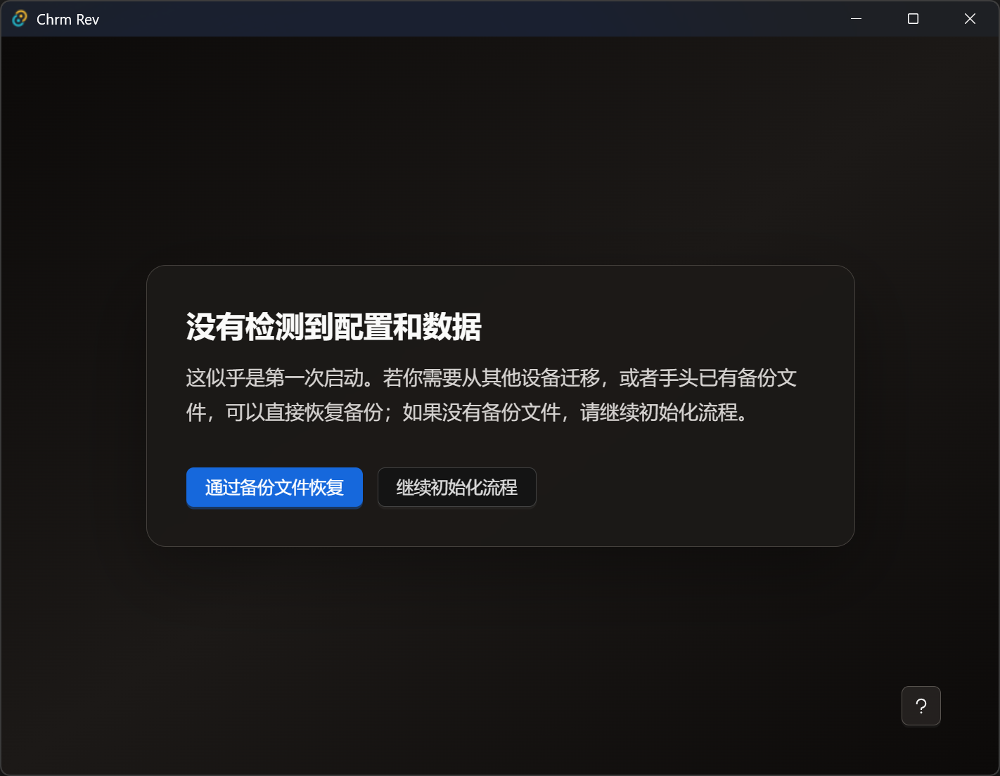

# 启动自检流程说明

Chrm Rev 启动时会连接[数据目录](./datadir.md)下的 chrm-rev.sqlite.db 数据库，并从数据库读取系统配置。

## BackupManager

首次启动或且尚无配置和已初始化的数据库时，会先跳转到恢复备份页面。

> 你可以在这里直接恢复备份的数据库文件，或跳过以继续初始化流程

## Configloader

如果数据库中没有系统配置，会优先进入这个页面，必须先保存配置才能继续。

[配置参考](./configloader.md)

## Dataloader

首次初始化时，保存配置后会进入数据导入页面，可继续导入业务数据或跳过导入。

[导入工具使用帮助](./dataloader.md)
